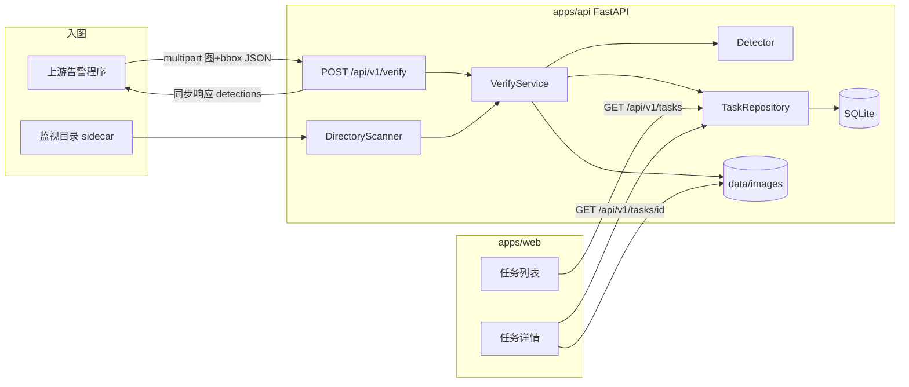

# DESIGN: 报警图片二次校验平台

- **Change ID**: alarm-image-verify
- **关联**: `@.specs/alarm-image-verify/REQUIREMENT.md`、`@.specs/CONTEXT.md`
- **作者**: AI（Architect 角色）+ 人工 review

---

## 0. 技术栈选定

> 由 2-design 步骤 0 锁定。变栈视为开新 CHANGE（R7.1）。

- **选定**: 1 FastAPI + React（Python AI / 数据后端）
- **前端**: Vite 5 · React 18 · TypeScript 5 · CSS 变量驱动工业风 UI（不用默认 Inter/紫渐变模板）
- **后端**: FastAPI 0.110+ · Pydantic v2 · Python 3.11+ · Uvicorn
- **数据库**: SQLite（SQLAlchemy 2 · Alembic）
- **部署**: Docker Compose（api + 可选静态资源；单机挂载 `data/` 与监视目录）
- **关键依赖**: ultralytics（检测默认实现）、Pillow、watchdog 或 asyncio 定时扫描、httpx（测试）
- **理由**: 同步二次识别与目录扫描需要 Python 视觉栈；与 AC-1/3 及 P95 软目标同进程最贴
- **明确排除**: Nest/Go 主 API（推理旁路复杂）；Tauri（非桌面需求）

---

## 0.5 既有架构对齐（brownfield 必填）

> 新创项目：N/A（空仓，无既有模块可对齐）。下列为**拟建**模块边界，供 TASK/DEV 使用。

### 0.5.1 本次 change 触碰的既有模块

```
触碰模块（既有）：
- （无）

新增模块（拟）：
- apps/api/          # FastAPI 应用：入图、查询、静态挂载
- apps/api/ingest/   # API 入图 + 目录扫描
- apps/api/detect/   # Detector 接口与 Ultralytics 实现
- apps/api/tasks/    # 任务仓储与状态
- apps/web/          # Vite React 审核日志台
- data/images/       # 原图存储
- data/inbox/        # 默认可配置监视目录（可改配置）

禁动清单：
- （尚无既有代码；DEV 不得引入与 AC 无关的多租户/鉴权/大盘模块）
```

### 0.5.2 既有抽象沿用对照表

| 本次需要 | 既有有没有？ | 决定 |
|---|---|---|
| HTTP API | 无 | 新建 FastAPI 路由 |
| 检测推理 | 无 | 新建 `Detector` 接口 + Ultralytics 实现 |
| 任务存储 | 无 | SQLAlchemy models + repo |
| 审核台 UI | 无 | 新建 Vite React |

### 0.5.3 沿用模式 vs 引入新模式

```
- 空仓：**引入** 分层：api 路由 → service → repo / detector
- 配置：环境变量 + 可选 YAML（监视目录、权重路径、扫描间隔）
- 前端数据：TanStack Query 拉列表/详情（简单场景，无全局复杂 store）
```

---

## 1. 决策清单

| # | 决策 | 备选 | 选择理由 | 取舍代价 |
|---|---|---|---|---|
| D1 | FastAPI + React | Nest+Python 旁路 / Go+旁路 | 见 ADR-001 | 双语言维护 |
| D2 | 请求内联同步推理 | 异步队列 | 见 ADR-002；对齐同步 AC | 并发能力有限 |
| D3 | SQLite + 本地磁盘存图 | Postgres + MinIO | 见 ADR-003；单机 v1 | 难水平扩展 |
| D4 | `Detector` 接口 + Ultralytics 默认 | 直接写死 YOLO API / 云 API | 见 ADR-004；命名不绑品牌 | 镜像大、GPU/CPU 环境敏感 |
| D5 | 目录扫描：可配置间隔轮询（默认 ≤10s） | inotify 实时 | 跨平台（含 Windows 开发）更稳 | 最坏延迟 ≈ 间隔 |
| D6 | 处理成功的 sidecar 移至 `done/` 或打 `.processed` 标记 | 删除源文件 | 可追溯、防重复扫描 | 需磁盘清理策略（v1 文档说明手工清） |
| D7 | API 与 Web 同仓 monorepo | 两仓 | 一人交付闭环快 | 构建脚本需约定 |
| D8 | v1 无鉴权 | API Key | 受信网假设（REQUIREMENT） | 暴露面靠网络隔离 |

---

## 2. 数据流 / 架构图



**同步 API 路径（AC-1）**

```
校验 multipart → 解析 bbox JSON → 写 data/images/{task_id}/origin.*
→ Detector.predict → 写 detections → commit 任务 success
→ 返回 { task_id, detections[] }
```

**目录路径（AC-3）**

```
每 N 秒列出 inbox → 匹配 stem 成对 → 调用同一 VerifyService
→ 成功后标记/移动 sidecar → 仅日志台可查（无回写上游）
```

---

## 3. 关键状态机（如有）

校验任务状态：

| 状态 | 含义 |
|------|------|
| `received` | 已接收入图，尚未推理完（同步路径上极短；目录路径可见） |
| `succeeded` | 二次识别完成，结果可查 |
| `failed` | 校验失败（坏图、推理异常等） |
| `skipped` | 目录仅有图无 json 等（AC-4；可不入库或入库为 skipped） |

```
received → succeeded
received → failed
（目录）unpaired file → skipped（日志 + 可选记录）
```

无「人工改判」状态（D-002）。

---

## 4. ADR 索引

- `@.specs/adr/001-fastapi-react-stack.md`
- `@.specs/adr/002-sync-inline-inference.md`
- `@.specs/adr/003-sqlite-local-storage.md`
- `@.specs/adr/004-ultralytics-detector.md`

---

## 5. 风险

| # | 风险 | 影响 | 概率 | 缓解 |
|---|---|---|---|---|
| R1 | 模型冷启动/首次推理过慢 | 同步 API 超时、达不到软目标 | 高 | 启动预加载；Uvicorn 超时与客户端超时文档化；健康检查含 `model_ready` |
| R2 | 监视目录与 API 重复投递同一逻辑告警 | 重复任务 | 中 | `alarm_id`+内容哈希去重（可选）；sidecar 处理后移位 |
| R3 | Ultralytics/Torch 镜像过大、CUDA 环境不一致 | 上线失败 | 中 | CPU 默认权重路径；Docker 分 `cpu`/`gpu` Dockerfile；文档写明设备配置 |
| R4 | SQLite 写锁 + 同步推理长事务 | 列表查询卡顿 | 低~中 | 短事务；图落盘与 DB 分离；连接 `timeout` |
| R5 | 工业风 UI 做成通用 AI-slop 仪表盘 | 违背调性、复核效率差 | 中 | 2a-ui-design 锁 tokens；禁紫渐变/无意义卡片墙 |

> R1 实现 · R3 上线 · R4/R5 长期债务与体验。

---

## 6. 不在范围

- 异步 task_id / Webhook 回写上游
- 日志台筛选、统计大盘、鉴权
- 多实例共享存储与 Postgres 迁移
- 框内裁剪二次检的产品化开关（仅留 Detector 扩展点）
- 模型训练与热更新平台

---

## 7. 主要接口草图（契约级，非实现）

```
POST /api/v1/verify
  multipart: file=<image>, bbox=<json string or file>
  200: { task_id, status, detections: [{ label, confidence, x?, y?, w?, h? }], alarm_bboxes: [...] }

GET /api/v1/tasks?limit=&offset=
  200: { items: [{ task_id, created_at, status, source }], total }

GET /api/v1/tasks/{task_id}
  200: { task_id, status, source, alarm_bboxes, detections, image_url }

GET /api/v1/tasks/{task_id}/image
  200: image bytes
```

错误：缺图/坏 JSON → 4xx + `{ detail }`。

---

## 9. 架构沉淀建议（本 change 完成后供 flow-evolve 同步用 · 软约束）

### 9.1 新增的可复用抽象

| 路径 | 能力 | 触发场景 | 复用建议 |
|---|---|---|---|
| `apps/api/detect/base.py` | `Detector` 协议 | 换权重/换 ONNX | 新检测后端只加实现，不改路由 |
| `apps/api/services/verify.py` | 入图→落盘→推理→落库 | API 与目录共用 | 禁止在路由里复制流程 |

### 9.2 新增 / 改变的项目级技术决策

| 决策 | 取值 | 影响范围 | 推翻代价 |
|---|---|---|---|
| 后端语言 | Python / FastAPI | 全仓 | 高（重写 API） |
| 元数据存储 | SQLite | 数据层 | 中（迁移 Postgres） |
| 推理集成 | 同步内联 | 吞吐模型 | 中（引入队列） |
| UI 调性 | 工业风 | Web | 低~中（restyle） |

### 9.3 新增 / 修改的跨模块契约

```
- HTTP：/api/v1/verify 与 /api/v1/tasks* （见 §7）
- bbox JSON schema：@.specs/CONTEXT.md 默认行为
- Detector.predict 返回结构：label + confidence + optional xywh
```

### 9.4 新增 / 升级的依赖

| 包 | 版本 | 用途 | 是否替换既有 |
|---|---|---|---|
| fastapi / uvicorn | 最新稳定 | API | 否（首引） |
| sqlalchemy / alembic | 2.x | ORM/迁移 | 否 |
| ultralytics | 最新稳定 | 检测默认实现 | 否 |
| react / vite | 18 / 5 | 审核台 | 否 |

### 9.5 禁动清单变化

```
- 新增禁动：鉴权中台、多租户 schema、统计大盘路由、Webhook 回写模块
- 解禁：（无）
```

---

> 本文件不包含完整代码实现。函数签名、伪代码、接口定义可以；函数体不行。
